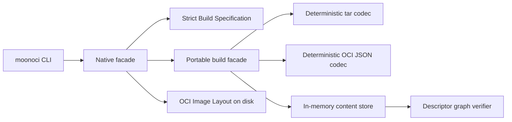

# Architecture

MoonOCI follows a two-tier facade.

The portable core contains the domain model, path policy, SHA-256 handling, deterministic tar codec, deterministic OCI JSON codec, strict Build Specification parser, in-memory content store, build engine, Root Filesystem application, and verifier. It has no host filesystem or process dependency and is checked for Wasm, Wasm-GC, JavaScript, and Native targets.

The Native facade traverses Layer Source directories, normalizes metadata, loads and writes OCI Image Layout files, and exposes the CLI. Host paths stop at this boundary; portable archive paths always use `/` and are normalized before entering the core.

The content store owns the invariant that Blob bytes match their Descriptor Digest and size. The build facade owns ordering between Layer Digest, DiffID, Image Configuration, Image Manifest, and Image Index. The verifier re-parses stored bytes rather than trusting build-time objects.

Layer Interpretation is the internal seam shared by verification and Root Filesystem reconstruction. It validates the declared media type, applies bounded gzip decoding, parses the tar through the archive safety policy, and derives the DiffID before a caller can consume Layer entries.

Both declarative build changesets and archived Whiteout entries become Root Filesystem Transitions. A single implementation applies additions, replacements, removals, and Opaque Directories, so build-time and reconstructed Root Filesystem semantics cannot drift independently.

Descriptor graph verification isolates independent Image Manifest branches. Findings carry precise object paths, while counters include only Blobs, Layers, and Image Manifests that completed their required checks.

Important decisions are recorded under `docs/adr/` and domain terminology under `CONTEXT.md`.
